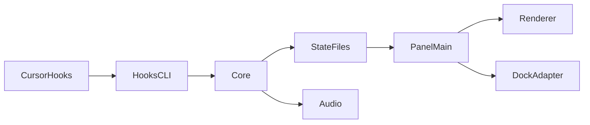

# Arquitectura

## Monorepo (objetivo)

```text
AgentCrew/                 # este repo
  apps/panel/              # Electron main + preload + React renderer
  packages/core/           # dominio puro (sin Electron)
  packages/hooks/          # CLI Node para Cursor
  packages/dock-windows/   # SHAppBarMessage (koffi / N-API)
  packages/dock-macos/     # panel always-on-top
  packages/dock-linux/     # X11 struts
  installer/               # copiar hooks + lanzar panel
  packages/tts/            # TtsProvider: Fish + ElevenLabs + resolver local (D10)
  voces/                   # frase-<sha256-16>.mp3 — copiar desde legacy (D6); no regenerar
  docs/
  AGENTS.md
  hooks.json
```

Legacy PS permanece fuera: `Downloads/panel-agentes` (ver `02-legacy-powershell.md`).

## Procesos



| Proceso | Responsabilidad |
|---------|-----------------|
| Hook CLI | Corto; escribe state; audio: `voces/` → Fish → fallback |
| Electron main | Ventana franja, dock, single-instance, focus Cursor, IPC |
| Preload | API tipada mínima al renderer |
| Renderer | Personajes / lista / click |

## Seguridad

- Renderer sandboxed; IPC allowlist
- No secretos TTS en repo (env / archivo local gitignored)
- Skills: `electron-best-practices`, `security-and-hardening`

## Empaquetado

electron-builder (o Forge) por plataforma. Dev: Vite HMR en renderer; main en watch.
